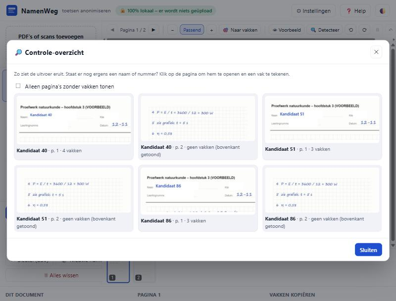

# NamenWeg

**Verwijder namen, examen-/leerlingnummers en klassen uit gescande toetsen – volledig lokaal in je browser.**

👉 **Gebruik de app: https://www.tomkooij.nl/namenweg/**



Gescande toetsen bevatten persoonsgegevens. Wil je ze laten nakijken door een collega, delen voor
een analyse of gebruiken als voorbeeld, dan moeten die gegevens eruit. NamenWeg doet dat:

1. Sleep een of meer PDF's (of JPG/PNG-scans) in de app – of klik op **🧪 Probeer met voorbeeld**
   voor drie neptoetsen met verzonnen namen.
2. De app zoekt **automatisch** naar voorgedrukte labels zoals *Naam kandidaat*, *Examen no.*,
   *Kandidaatnummer*, *Leerlingnummer* en *Klas*, en markeert de ingevulde vakken.
3. Controleer per pagina, pas vakken aan of teken er zelf een.
4. Exporteer: de persoonsgegevens worden **écht verwijderd** en vervangen door bijvoorbeeld
   *Kandidaat 67*.

## Privacy

- **Er wordt niets geüpload.** De app is een statische webpagina; bestanden worden alleen in het
  geheugen van je eigen browser geopend.
- **Tekstherkenning (OCR) draait lokaal** met [Tesseract.js](https://github.com/naptha/tesseract.js)
  (WebAssembly). De OCR-engine en de taalmodellen (Nederlands + Engels) worden vanaf dezelfde
  website geladen, niet van een externe CDN.
- Een strikte **Content-Security-Policy** verbiedt de browser om verbinding te maken met andere
  servers.
- Werkt volledig **offline**: bij het eerste bezoek slaat de service worker alle onderdelen op
  (app, OCR-engine en taalmodellen, pdf.js-decoders; ca. 30 MB, eenmalig). Rechtsonder staat dan
  "✓ werkt offline". De lijst met bestanden wordt bij het bouwen gegenereerd (`vite.config.ts`).
- In de browser worden alleen bewaard: instellingen, sjablonen (alleen posities van vakken) en de
  OCR-taalmodellen (openbare data, voor offline gebruik). Nooit scans of namen. Sluit je het
  tabblad, dan zijn alle geopende documenten weg.

## Echt verwijderen

Een zwart vlak óp een PDF leggen is niet veilig: de oorspronkelijke scan zit er nog onder. NamenWeg
bouwt daarom elke pagina opnieuw op:

1. de pagina wordt gerenderd naar pixels;
2. de pixels van de gemarkeerde vakken worden overschreven (wit of zwart) en de vervangende tekst
   wordt erin getekend;
3. alleen díé nieuwe afbeelding gaat in een gloednieuwe PDF – zonder originele beeldlagen,
   tekstlagen of metadata (auteur, scanner, datum, bestandsnaam).

Na de export wordt elk bestand automatisch gecontroleerd: geen tekstlaag, precies één afbeelding per
pagina, en geen namen of de oorspronkelijke bestandsnaam in de metadata (Info en XMP).

## Functies

- Automatische detectie van naam, examen-/leerlingnummer en klas (instelbare trefwoorden),
  ook bij lichtgrijze, gerasterde voorgedrukte labels
- Vakken groeien mee met het handschrift en met invulhokjes onder een label
- Vangnet: mist de OCR een label op één pagina, dan wordt het vak aangevuld op basis van
  dezelfde kop op andere pagina's/documenten. Ook als het label onleesbaar is (bijv. een
  handtekening dwars door "NAAM:") en er op die pagina verder niets gevonden is: is het hetzelfde
  gedrukte blad als bij andere leerlingen, dan wordt hun naamvak overgenomen, uitgelijnd op de
  gedrukte tekst en bijgesneden op de inkt
- Tweede OCR-ronde op het onbewerkte beeld als handschrift tegen het naamlabel aan staat
- Zoekt de naam uit de bestandsnaam (bijv. `jansen piet.pdf`) ook elders op de pagina, net als
  een optionele namenlijst (bijv. de hele klas; wordt nooit opgeslagen). Korte namen (< 5
  letters) alleen exact, langere met één tikfout; zo'n losse treffer krijgt geen vervangende tekst
- Tweede OCR-ronde zonder gekleurde inkt als handschrift het naamlabel onleesbaar maakt
- Werkt ook op gedraaide pagina's (bijv. liggende uitwerkbijlagen)
- Controle-overzicht: van elke pagina een uitsnede van het eindresultaat in één scherm
- Waarschuwing als een pagina geen vak heeft terwijl dezelfde pagina bij anderen wel vakken heeft
- Sjablonen: vaklayout opslaan en op een volgende klas toepassen (alleen posities, geen namen)
- Vakken tekenen, verplaatsen (ook met pijltjestoetsen), schalen, verwijderen; ongedaan
  maken/opnieuw; Shift+slepen voor een strook over de volle breedte
- Eén scan van de hele klas wordt na de detectie automatisch per leerling opgedeeld als de
  naamvakken op een vast ritme staan (bijv. elke 2e pagina) én die pagina's hetzelfde voorblad
  zijn (vergelijking van de gedrukte tekst); elke leerling krijgt zo een eigen kandidaatnummer.
  Eén leerling met de naam op elk (ander) blad wordt dus niet gesplitst. Hebben leerlingen
  niet allemaal evenveel pagina's (bijv. 4, 6 of 8), dan wordt gesplitst bij elk blad dat
  gelijk is aan pagina 1 (het voorblad); een slecht gelezen voorblad wordt afgeleid uit het
  blad erna. Is de verdeling ongelijk of twijfelt de app, dan opent het venster
  "Splitsresultaat" (schermvullend, één gekleurde rij per kandidaat; toont de weg te halen vakken of
  precies het exportresultaat, en waarschuwt bij een kandidaat zonder naamvak; klik om op een kandidaat in
  te zoomen met de buren erboven en eronder in beeld, pagina's naar een andere kandidaat slepen,
  splitsen met ✂ of een rij samenvoegen met de vorige); bij een gelijke verdeling niet, maar dan staat er "Bekijken" in de melding en
  "✂ Splitsing bekijken/aanpassen…" bij het document. Terug te draaien via de melding, uit te
  zetten in Instellingen. Het oogje bij "Dit document" laat
  zien wat de tekstherkenning per pagina zag en hoe de splitsheuristiek besliste. Handmatig
  splitsen kan ook (vast aantal pagina's, bij elk naamvak of vóór een pagina), net als
  documenten samenvoegen (bijv. een apart gescande uitwerkbijlage)
- Voorbeelden met verzonnen namen: drie losse toetsen, of een hele klas in één PDF. In dev ook
  `?demo=klas` (moet splitsen), `?demo=bladen` (één leerling met de naam op elk blad: mag niet
  splitsen), `?demo=beide` of `?demo=wisselend` (klas met 2, 3, 1 en 2 pagina's per leerling: het
  splitsvenster opent)
- Pagina's draaien (vakken draaien mee), inzoomen op de vakken, pagina's als gecontroleerd markeren
- Snelle detectie in twee fasen: eerst rechtop, daarna op de achtergrond gedraaide pagina's
- Vakken kopiëren naar alle pagina's / alle documenten
- Willekeurige, unieke kandidaatnummers (niet herleidbaar uit de volgorde)
- Instelbare vervangende tekst (`Kandidaat {n}`), kleur, hoekstempel op elke pagina
- Voorbeeldweergave van het resultaat
- Export per document, als ZIP of als één samengevoegde PDF; elke kandidaat krijgt een bladwijzer
  (inhoudsopgave) op zijn eerste pagina, ook in de samengevoegde PDF – met alleen "Kandidaat 67",
  nooit een naam
- **✏️ Snel wissen** (☰ Menu, het startscherm, of direct via `?snelwissen`): iets gemist in een al
  geëxporteerde PDF? Open hem, trek met de muis een vak (Shift = strook over de volle breedte) en
  sla op. Geen tekstherkenning en geen splitsen. De weergave lijkt op het splitsvenster: één rij per
  kandidaat, gelezen uit de bladwijzers; klik om in te zoomen. Alleen pagina's met een nieuw vak
  worden opnieuw opgebouwd (écht weggehaald); de andere pagina's gaan ongewijzigd mee, tenzij ze
  nog tekst of meer dan één afbeelding bevatten. Daarna volgt dezelfde automatische controle
- Optioneel sleutelbestand (CSV) om later terug te vinden wie wie was – blijft op je computer
- **Leerlingen koppelen** aan een leerlinglijst (CSV of Excel .xlsx, ook exports met losse kolommen
  Roepnaam/Tussenvoegsel/Achternaam, Leerlingnummer en Klas): per toets zie je de naamvakken uit de
  scan, typ een paar letters (of initialen, of het leerlingnummer) en druk op Enter. Bij meerdere
  passende namen kies je met 1, 2 of 3; staat de naam in de bestandsnaam, dan staat die al klaar.
  Een leerling met meer dan één toets wordt rood, met de andere toets ernaast om het handschrift te
  vergelijken en een knop om samen te voegen of de splitsing aan te passen. Overzicht (Ctrl+O) met
  wie nog geen toets heeft; nieuwe leerling toevoegen (Shift+Enter) of "niet in lijst" (Ctrl+Enter);
  ongedaan maken (Ctrl+Z). De kandidaatnummers blijven willekeurig; de koppeling (met leerlingnummer
  en klas, plus de leerlingen zonder toets) staat alleen in het sleutelbestand. De lijst wordt niet
  opgeslagen
- Resolutie, JPEG-kwaliteit (standaard automatisch: ongeveer even groot als het origineel) en
  grijswaarden instelbaar
- Licht en donker thema, sneltoetsen, offline bruikbaar

## Zelf draaien

```bash
npm install
npm run dev      # ontwikkelserver op http://localhost:5178
npm run build    # productiebuild in dist/
```

Detectie testen op eigen (lokale!) scans in `scans/`:

```bash
npm run test:render   # pagina's renderen naar .testdata/ (vereist Python + PyMuPDF + Pillow)
npm run test:detect   # OCR + detectie in Node, tekent vakken in .testdata/vis-*.png
```

`npm run dev`/`build` kopiëren eerst de OCR-engine, taalmodellen en pdf.js-bestanden naar `public/`
(zie `scripts/copy-assets.mjs`).

> ⚠ Zet nooit echte scans in deze repository. `.gitignore` sluit `scans/`, PDF's, afbeeldingen en
> CSV-bestanden uit.

## Techniek

Vite + TypeScript, [pdf.js](https://mozilla.github.io/pdf.js/) (inlezen/renderen),
[pdf-lib](https://pdf-lib.js.org/) (nieuwe PDF), [Tesseract.js](https://tesseract.projectnaptha.com/)
(OCR), [fflate](https://github.com/101arrowz/fflate) (ZIP).

## Licentie

MIT
